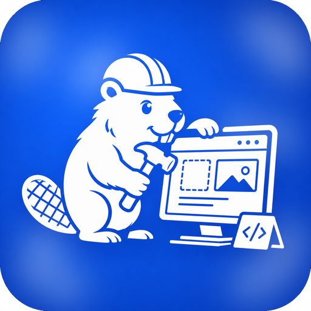
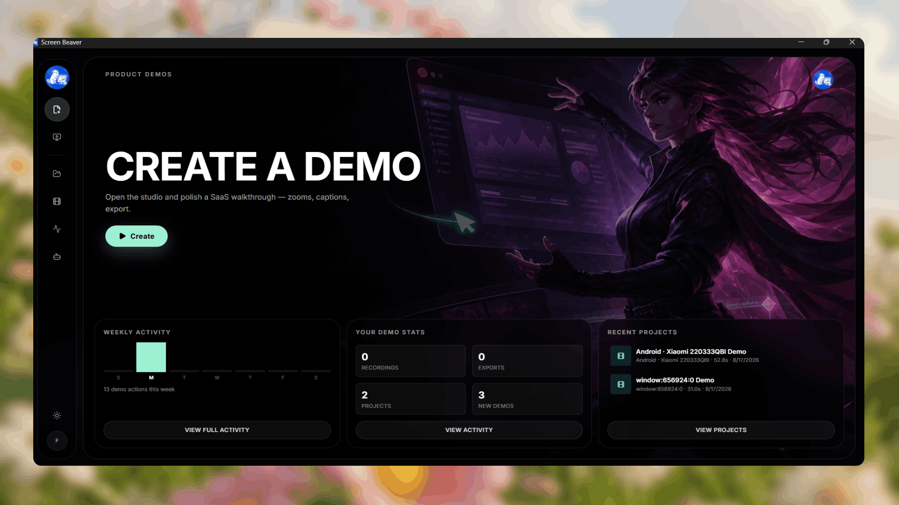
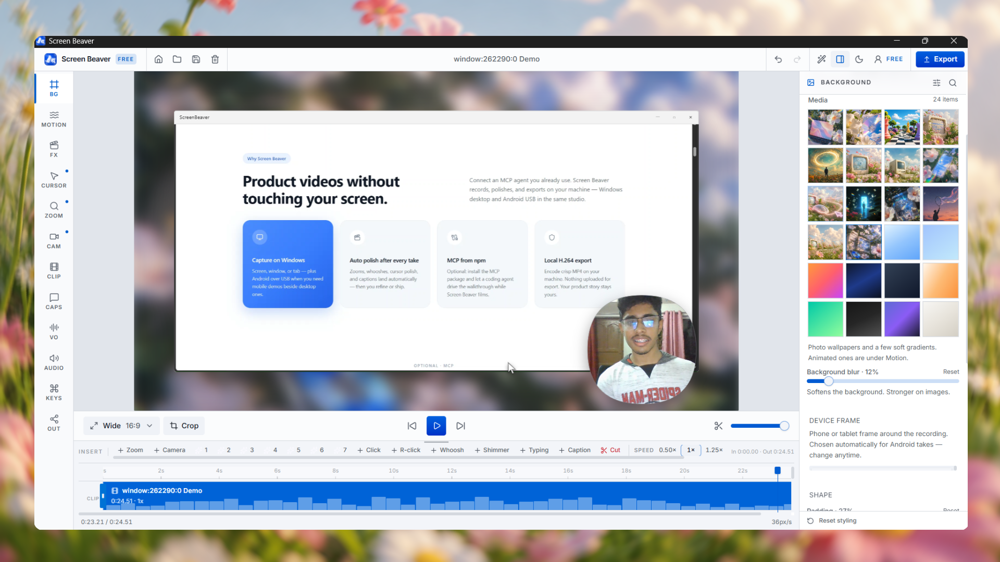
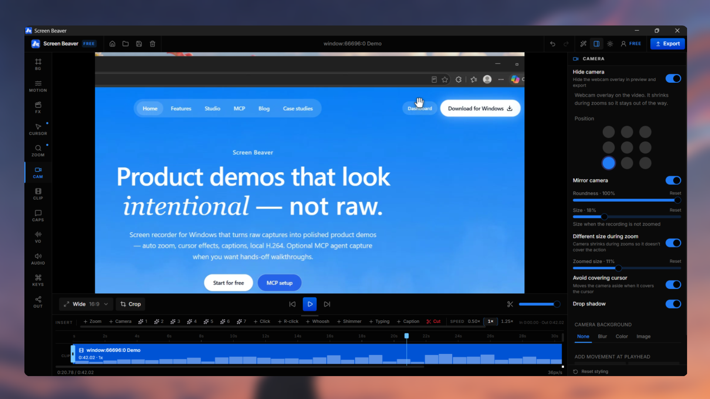
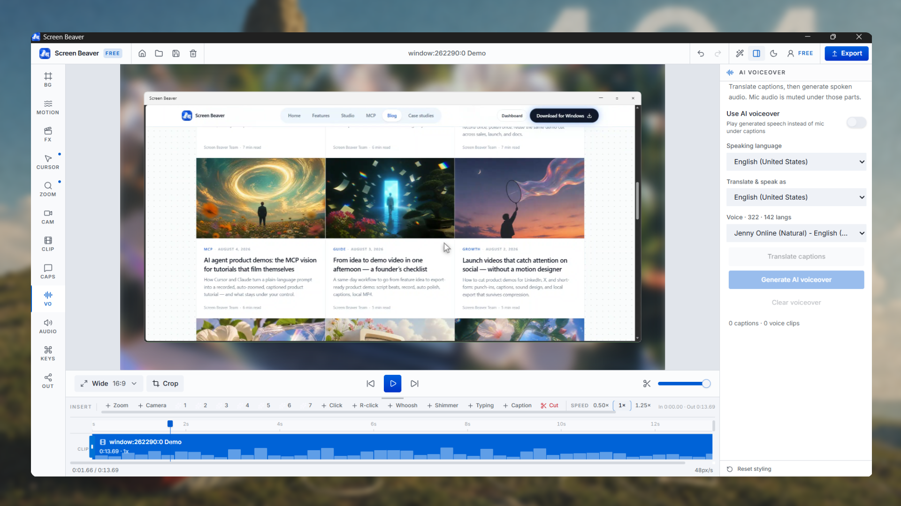
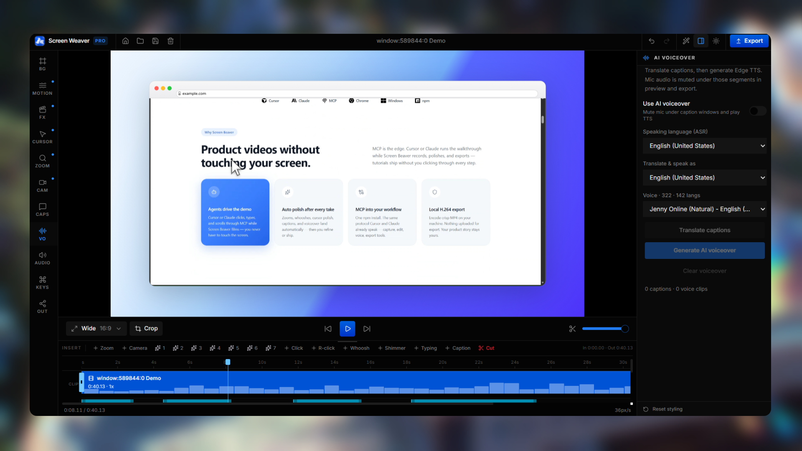
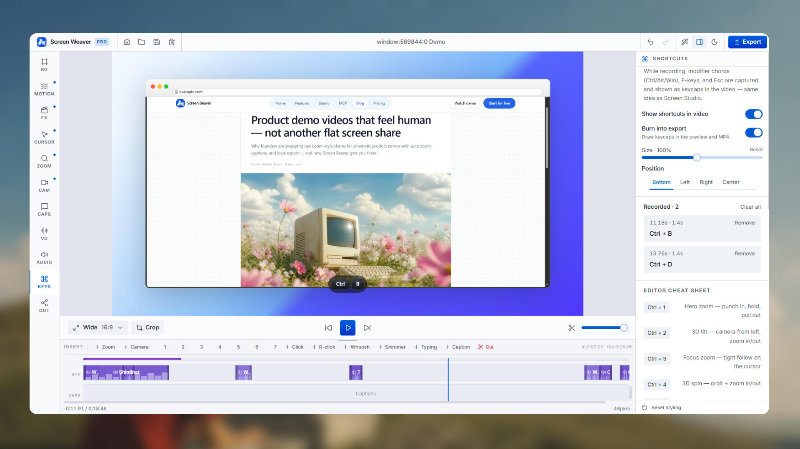
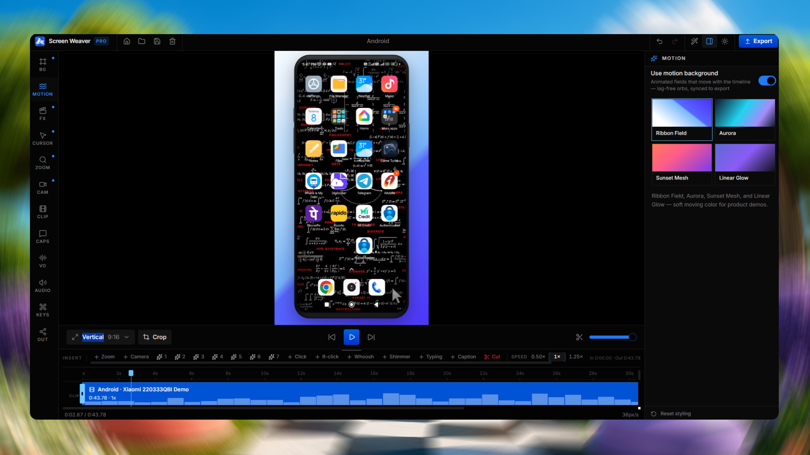

<p align="center">
  
</p>

<h1 align="center">Screen Beaver</h1>

<p align="center">
  <strong>Open-source desktop screen recorder &amp; motion editor for product videos.</strong><br/>
  Record any window or screen · polish with zooms, captions &amp; effects · export a crisp MP4 — locally.
</p>

<p align="center">
  <a href="#screenshots">Screenshots</a> ·
  <a href="#features">Features</a> ·
  <a href="#quick-start">Quick start</a> ·
  <a href="#mcp--ai-agents">MCP</a> ·
  <a href="#documentation">Docs</a> ·
  <a href="#license">License</a>
</p>

<p align="center">
  
  
  
  
</p>

---

## Screenshots

<p align="center">
  
</p>

<p align="center"><em>Home — create demos, see weekly activity, and jump back into recent projects.</em></p>

<p align="center">
  
</p>

<p align="center"><em>Studio — backgrounds, camera PiP, timeline, and local export.</em></p>

<p align="center">
  
  &nbsp;
  
</p>

<p align="center"><em>Left: camera &amp; timeline · Right: AI voiceover (translate + Edge TTS).</em></p>

<p align="center">
  
  &nbsp;
  
</p>

<p align="center"><em>Left: MCP / agent-driven demos · Right: keyboard shortcut overlays in the video.</em></p>

<p align="center">
  
</p>

<p align="center"><em>Android USB takes — vertical 9:16, motion backgrounds, full timeline polish.</em></p>

---

## Why Screen Beaver?

Most “screen recorders” stop at a raw take. Screen Beaver is a **studio for product stories**:

| Without Screen Beaver | With Screen Beaver |
| --- | --- |
| Jumpy cursor, no focus | Smoothed cursor + cinematic zooms |
| Manual caption grind | Live captions + AI voiceover |
| Flat full-screen dump | Device frames, chrome, motion backgrounds |
| Separate tools for polish | One timeline: zooms · FX · SFX · captions |
| Cloud-only editors | **Local** H.264 export — nothing uploaded to encode |

All studio features in this open-source build are **free offline**. Optional cloud sign-in is only for share links.

---

## Features

### Capture

| Feature | Details |
| --- | --- |
| **Screen / window / tab** | Full display, app window, or browser tab |
| **Native desktop capture** | Record without the OS share picker (Tauri) |
| **System-wide cursor hook** | Track pointer + hotkeys even inside Excel / native apps |
| **Camera + mic + system audio** | Optional selfie PiP and narration tracks |
| **Android USB** | Mirror + record phones via portable ADB/scrcpy |
| **Companion extension** | Sharper tab-relative cursor & zooms in Chrome/Edge |

### Edit & polish

| Feature | Details |
| --- | --- |
| **Auto zooms** | Derived from clicks, typing, and interaction density |
| **Manual zooms** | Place, scale, follow-cursor, vertical reframe for 9:16 |
| **Scene effects** | Hero zoom, 3D tilt/spin, glare, mockup reveal, and more |
| **Cursor polish** | Smoothing, click ripples, real OS cursor shapes |
| **Captions** | Live ASR while recording, edit cues, export `.srt` |
| **AI voiceover** | Translate captions + Edge TTS neural voices |
| **SFX bed** | Click, whoosh, shimmer, typing — auto or manual |
| **Keyboard overlays** | Shortcut callouts burned into the frame |
| **Backgrounds** | Wallpapers, gradients, motion fields, custom images |
| **Device / window frames** | Phone shells, browser/macOS/Windows chrome |
| **Timeline** | Multi-lane edit with cut, trim, speed, undo/redo |

### Export & agents

| Feature | Details |
| --- | --- |
| **Local MP4** | 720p → 4K, 24/30/60 fps, Web/High/Max quality |
| **No watermark** | Open-source build ships watermark-free |
| **MCP bridge** | Let Cursor / Claude drive demos while you watch |
| **Projects** | Save / open `.yasharka` project files |

Full product surface: **[docs/FEATURES.md](./docs/FEATURES.md)**.

---

## Quick start

### Prerequisites

| Tool | Notes |
| --- | --- |
| **Node.js 20+** | `npm` included |
| **Rust (rustup)** | Required for Tauri |
| **WebView2** | Windows desktop runtime |
| **Chrome or Edge** | Recommended for WebCodecs export |

### Install & run (desktop)

```bash
git clone https://github.com/ScreenBeaver/ScreenBeaver.git
cd ScreenBeaver
npm install
npm run desktop:dev
```

### Web UI only

```bash
npm run dev
```

Web mode still records via the browser picker, but loses system-wide cursor tracking and Android USB.

---

## Scripts

| Command | Description |
| --- | --- |
| `npm run desktop:dev` | Tauri desktop app (hot reload) |
| `npm run desktop:build` | Release EXE (no nested installer) |
| `npm run desktop:build:store` | Store-oriented build + MSIX payload stage |
| `npm run dev` | Web studio only |
| `npm run build` | Frontend production build |
| `npm run mcp` | Start the local MCP server |
| `npm run mcp:build` | Bundle MCP for publish / `npx` |

---

## MCP / AI agents

Screen Beaver exposes a local bridge (`127.0.0.1:17355`) and an MCP server so agents can:

- open apps / URLs
- move, click, type, and scroll during a capture
- add captions, zooms, effects, and music
- run `record_and_build` / live demo flows while you watch

```bash
npm run mcp:install
npm run mcp:build
npm run mcp
```

See [`mcp/README.md`](./mcp/README.md) and [`docs/PUBLISHING.md`](./docs/PUBLISHING.md).

---

## Project layout

```text
ScreenBeaver/
├── src/                 # React studio (TanStack Start)
├── src-tauri/           # Tauri / Rust desktop shell + native capture
├── mcp/                 # MCP server (agent tools)
├── extension/           # Chrome/Edge companion
├── packaging/msix/      # Microsoft Store packaging helpers
├── public/              # Runtime assets (sounds, wallpapers, official logo)
├── docs/                # Documentation + README media
│   ├── FEATURES.md
│   ├── DESKTOP.md
│   ├── DESKTOP_ACCOUNT.md
│   ├── PUBLISHING.md
│   └── assets/
│       ├── logo.png           # Official Screen Beaver logo
│       └── screenshots/       # Product screenshots for GitHub
├── recipes/             # Example polish recipes
└── LICENSE
```

---

## Configuration

Copy `.env.example` → `.env` only if you need overrides. **Never commit a real `.env`.**

| Variable | Purpose |
| --- | --- |
| `VITE_SCREENBEAVER_API_URL` | Optional cloud API (sign-in / share). Default `https://screenbeaver.com` |

Studio features work fully **offline** without an account.

---

## Microsoft Store packaging

Tauri does not emit MSIX. Build the release binary, stage the payload, then package with Visual Studio / MakeAppx:

```bash
npm run desktop:build:store
```

Details: [`packaging/msix/README.md`](./packaging/msix/README.md) · replace placeholder Partner Center identity before Store submission.

---

## Documentation

| Doc | Contents |
| --- | --- |
| [docs/FEATURES.md](./docs/FEATURES.md) | Complete feature guide (recording → export → MCP) |
| [docs/DESKTOP.md](./docs/DESKTOP.md) | Desktop architecture, build, extension bridge |
| [docs/DESKTOP_ACCOUNT.md](./docs/DESKTOP_ACCOUNT.md) | Optional cloud account handshake |
| [docs/PUBLISHING.md](./docs/PUBLISHING.md) | Publishing the MCP package to npm |
| [mcp/README.md](./mcp/README.md) | MCP tools & agent setup |
| [packaging/msix/README.md](./packaging/msix/README.md) | Store / MSIX notes |

---

## Stack

| Layer | Tech |
| --- | --- |
| UI | React 19, TanStack Start / Router, Tailwind CSS |
| Desktop | Tauri 2, Rust |
| Encode | WebCodecs → H.264 MP4 (local) |
| Agents | Model Context Protocol (`screen-beaver-mcp`) |
| Voice | Edge TTS (optional network) |
| Music | Openverse CC catalog via MCP (optional) |

---

## Contributing

1. Fork & clone the repo  
2. `npm install` · `npm run desktop:dev`  
3. Keep PRs focused; don’t commit `.env`, `node_modules`, `src-tauri/target`, or MSIX payloads  
4. Prefer clear commit messages (what changed and why)

---

## License

[MIT](./LICENSE) © Screen Beaver

---

<p align="center">
  <br/>
  <sub>Record · Polish · Export — locally.</sub>
</p>
